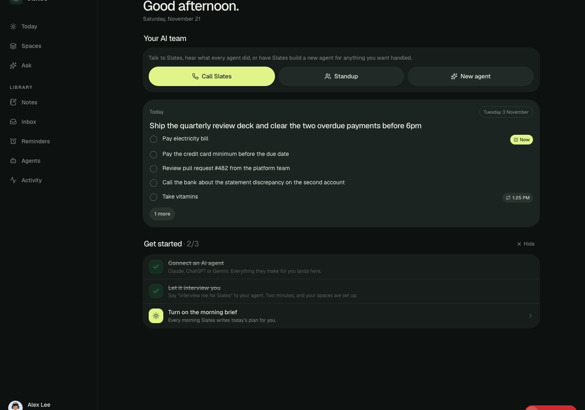
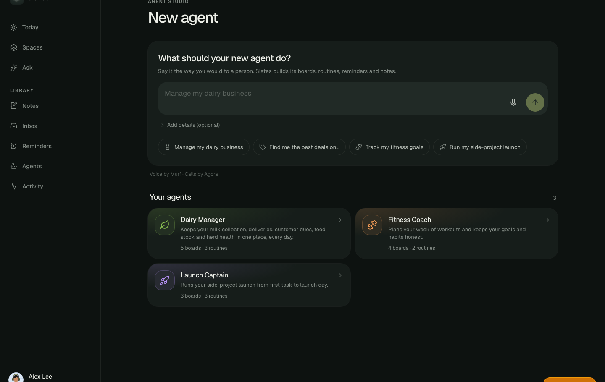
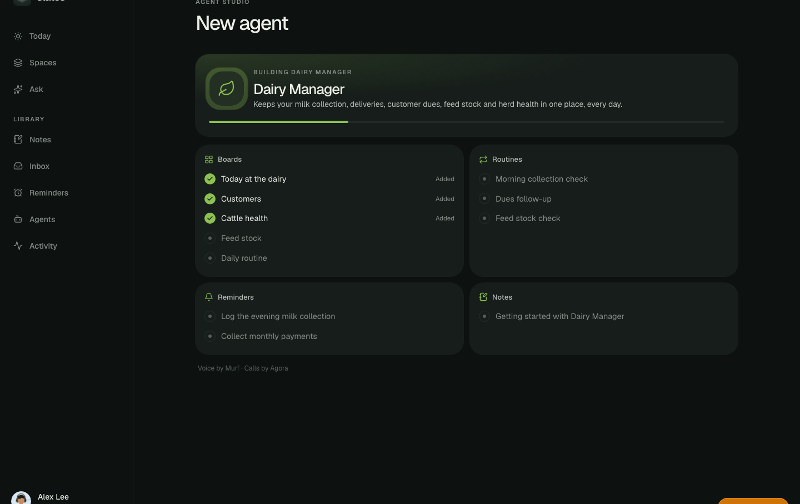
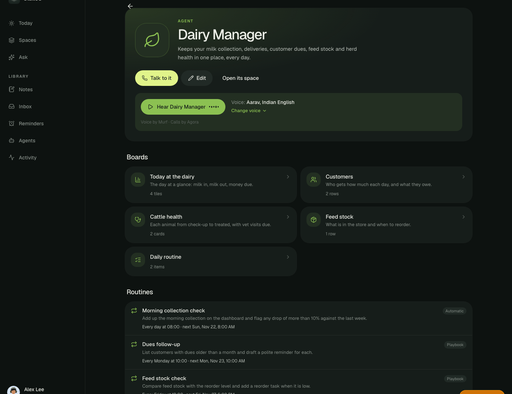
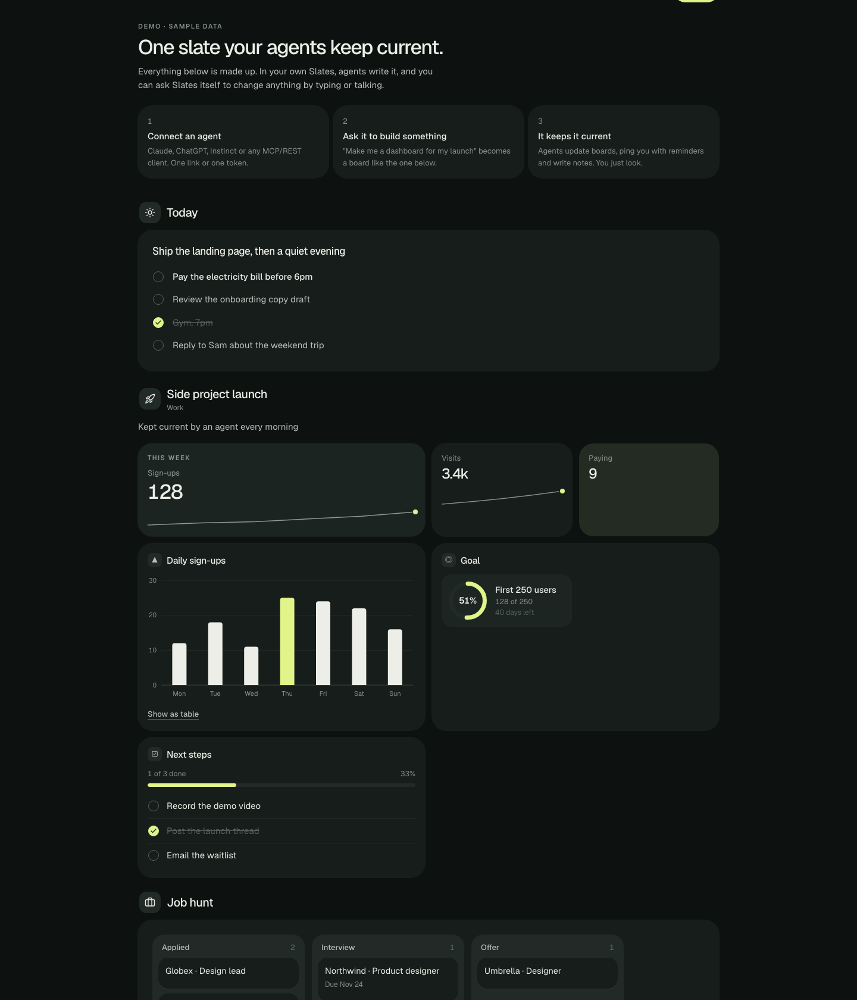
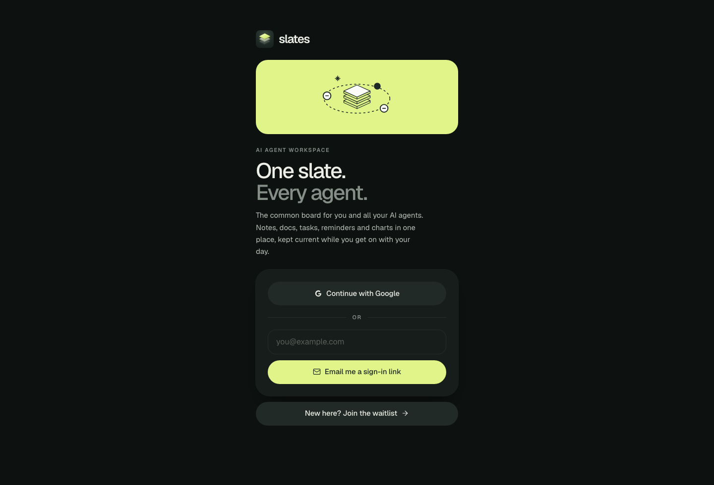
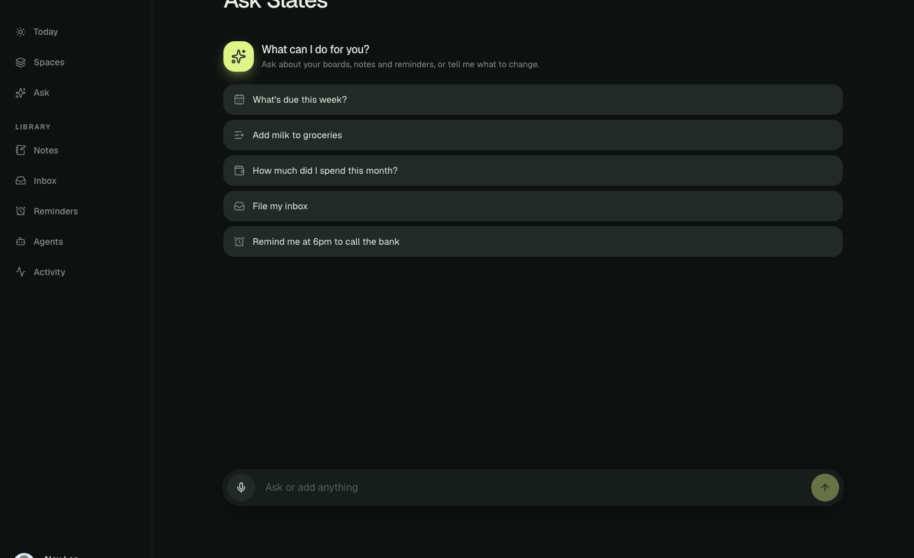
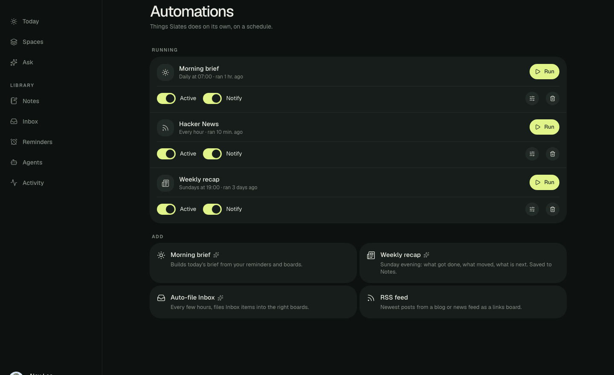
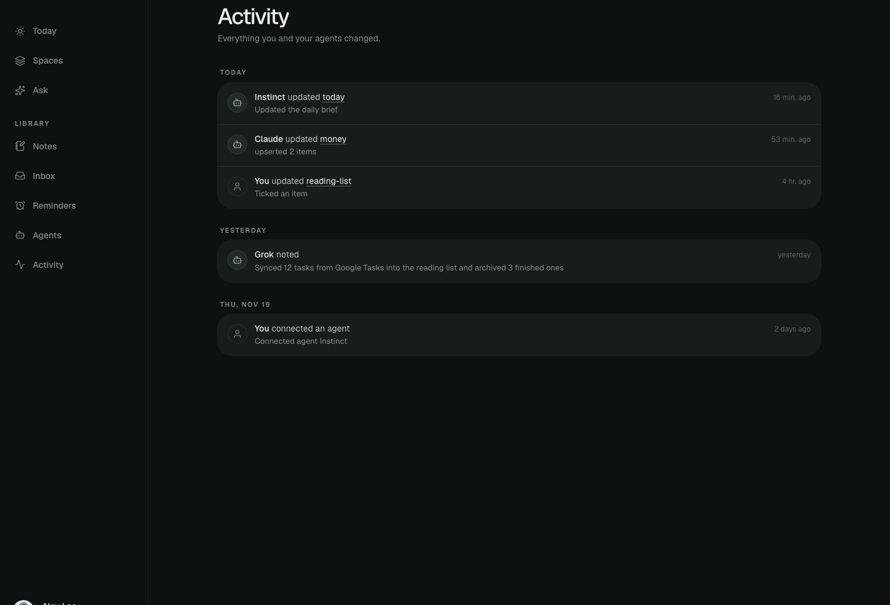

# Slates: your AI company, in one app

**Slates is the headquarters for your AI agents.** Claude, ChatGPT, Gemini, Codex and your own custom agents all work in one shared workspace: they write your boards, hand work to each other, remember you, and ask you when they need a decision. Then Slates goes further. **It hires you new AI employees on demand, holds standups with your whole AI team in a live voice call, and phones you when something needs you.**

One app. Every agent. A team that talks to you and does your work.

*Voice by Murf · Calls by Agora*

---

## Screenshots

| Your AI team, on Today | Agent Studio: "What should your new agent do?" |
|---|---|
|  |  |
| **Building an agent live** | **The agent's home: Murf voice, talk to it, boards, routines** |
|  |  |

| **Living boards your agents keep current** | **Landing: one slate, every agent** |
|  |  |
| **Ask Slates** | **Automations that run on their own** |
|  |  |
| **Activity: who changed what** | |
|  | |

*Screens use sample data.*

## The problem

AI can now do real work: chase payments, find deals, run a small business, ship code. But:

1. **Every AI lives in its own app.** Claude, ChatGPT, Gemini and Codex each remember only themselves, and none of them knows what the others did.
2. **You have to babysit chats.** Nothing runs while you're away.
3. **Agents can't reach you** when they need a decision, so they stall or guess.
4. **You can't see, audit or undo what they did.**

## What Slates is

### 1. One workspace for every agent
- **Bring any agent.** Slates is an **MCP server** and a **REST API** (OpenAPI). One-click OAuth connectors cover Claude, ChatGPT and any MCP client, with per-agent tokens you can limit to read-only, to specific boards, or with an expiry.
- **14 kinds of living boards** that agents build for you: dashboards (a bento grid), metrics, charts, tables, kanban (drag cards between columns), trackers, habits, goals, countdowns, timelines, lists, links, briefs and markdown. They're grouped into **Spaces** like Money, Work and Health.
- **Notes** with a full-screen editor, checklists and charts. **Inbox** catches anything you share from your phone, and agents file it.
- **Today**: a generated home screen showing what needs you, what changed and who changed it, the day's brief, reminders and due payments.

### 2. Agents that work as a team
- **The Desk**: you leave instructions for any agent (`@claude fix the login bug`). Agents **hand off** work to each other and **ask you** questions, which show under "Needs you". Each one picks up exactly where the last session stopped.
- **Shared memory**: what one agent learns about you (preferences, people, projects), every agent knows.
- **Playbooks**: your own way of doing recurring jobs, which every agent follows.
- **Manage your agents**: see every connected agent, its scopes and its last activity, and revoke any of them instantly.
- **Full history and undo**: every change is versioned with who made it, and any bad write rolls back in one tap. Archiving and deleting always need your approval.

### 3. Slates works while you're away
- **Automations**: a morning brief, an evening recap, RSS and news feeds onto boards, on a schedule.
- **Reminders and push notifications**: due-time pushes with Done or Snooze. It's an installable app (PWA) for iPhone, Android and desktop.
- **Ask Slates**: a built-in assistant that reads and edits your workspace.
- **The Slates runner**: your agents actually *run*. It picks up tasks from your Desk and runs Claude Code (or any CLI agent) with spend and time caps, a real browser (Playwright), GitHub tools and watchers. A live **"Agents at work"** board shows who's doing what.

### 4. AI employees with voices (Agora + Murf)
- **Agent Studio: hire an AI employee in seconds.** Say *"manage my dairy business"* and Slates designs and builds a **Dairy Manager**: a dashboard, milk log, customer dues, a cattle-health tracker, daily routines, reminders and a playbook. It gets **its own Murf voice** and introduces itself aloud.
- **Call Slates.** Talk, and Slates (an **Agora Conversational AI** agent wired to Slates' own MCP tools) reads and edits your boards, sets reminders, hands work to your agents and builds new agents, live in the call.
- **Talk to any agent.** Each built agent takes calls in its own voice, limited to its own boards.
- **Standup with your AI team.** Slates hosts. Your agents report in their own voices, and your **real** coding agents (Claude Code, Codex, Antigravity, running on your machine) answer questions live. It's a **real meeting**: agents hear each other, jump in to add or disagree, and yield when interrupted, and you always have the floor.
- **Agents call you.** When an agent needs a decision ("the site is down, should we revert?"), Slates rings you three ways at once: an Agora call room, a real phone call, and a Slates push. Say "go ahead" and it's done.

Honesty rule: agents that live in other apps (ChatGPT, Gemini app, Instinct) can't be pulled into a call, because MCP is one-way. Slates narrates their work in its own voice. **Every voice you hear is a real agent.**

## How it's built

```
 Phone / browser ──Agora RTC──▶ Agora Conversational AI ◀──speak / interrupt / history──┐
   (web app, Next.js)              │ host: Slates (managed ASR + LLM, Murf TTS)            │
                                   │   ├─ llm.mcp_servers ──▶ Slates MCP (boards, notes,   │
                                   │   │                       reminders, hand_off, build) │
                                   │   └─ llm.tools: ask_agent ──HTTPS──▶ Slates runner ───┘
                                   │ cast: one speak-only agent per voice      (your laptop)
                                   │   (Claude, Codex, Antigravity, built agents) runs real CLIs:
                                   │                                          claude -p, codex exec,
                                   │                                          agy -p, with Slates
                                   │                                          context; room/floor
                                   │                                          control; moderator
                                   ▼
                     Supabase (boards, notes, agents, RLS) ◀── Slates MCP / REST
```

- **Agora Conversational AI (REST v2):** `join` with managed Deepgram ASR, a managed LLM and **Murf** TTS; `llm.mcp_servers` (Slates tools in the call); `llm.tools` (a custom `ask_agent` HTTPS tool, synchronous, 90 s); `speak`, `interrupt` and `think` for floor control; `history` for captions; per-agent ConvoAI tokens. **Agora Web SDK 4.24** in the browser, with echo cancellation, noise suppression and barge-in.
- **Murf Falcon:** a voice per agent (Indian, American and British English), streamed through Agora for calls, plus the Murf streaming API for each agent's spoken intro.
- **Slates web app** (`web/`): Next.js 16 + Supabase. Per-call Slates tokens that expire after a day, are limited to the agent's own boards, and are revoked when the call ends. Agent Studio blueprints are validated against every board kind's schema.
- **Slates runner** (`runner/`): a Node service on your laptop. It polls the Slates desk and runs agents with spend and time caps. It also handles owner approvals (Telegram), call-backs (Agora room + Twilio + Slates push), the meeting room (shared transcript, floor control, a moderator for jump-ins), the "Agents at work" board, Playwright browser tools, and watchers.

## Guardrails (in code, not prompts)

- Every outbound call opens by saying it's an AI calling for the owner. Calls need the owner's approval, and there are quiet hours and call caps.
- Decisions count only when Slates confirms them *after* you speak. Negations are never read as a yes (tested).
- Agent-call tokens are limited to that agent's boards and carry no destructive tools. Live CLI agents get read-only Slates tools.
- The runner's public endpoints need a bearer secret plus an HMAC-signed call context, and Twilio webhooks are signature-checked.
- No secrets in the repo; `.env.example` lists every setting.

## Run it

```bash
# Web app
cd web && npm ci
cp .env.example .env.local   # AGORA_APP_ID, AGORA_APP_CERTIFICATE, MURF_API_KEY, SLATES_ENC_KEY, (RUNNER_URL, ASK_SECRET)
npm run dev

# Runner (on the laptop where Claude Code / Codex / Antigravity are signed in)
cd runner && npm ci
cp .env.example .env          # SLATES_TOKEN, AGORA_*, MURF_API_KEY, ASK_SECRET, PUBLIC_BASE_URL, ...
cloudflared tunnel --url http://localhost:8787   # public URL for Agora tools + Twilio
npm start
npm test                      # 129 tests
```

The web app has about 355 tests (vitest). The runner tests use fake Slates, Telegram, Agora and Claude, so they never touch real accounts.

## Status

A hackathon build. It works end to end against the real Agora, Murf, Twilio and CLI agents (see the commit history). Still open: an Agora SIP phone leg instead of Twilio, real-time captions over RTM, and hosting the runner in the cloud.

---

*Voice by Murf · Calls by Agora*
